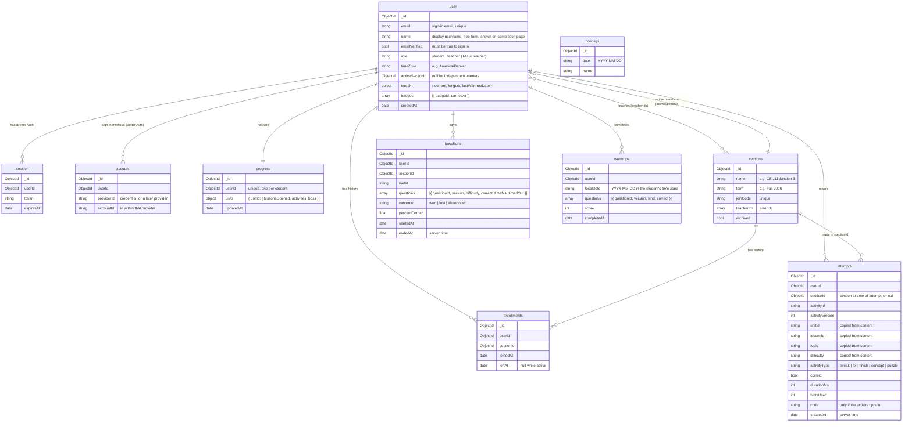

# PyTrek data model (DRAFT for review)

PyTrek uses **MongoDB Atlas**. Each box below is a collection. Fields shown as
`{...}` or `[...]` are **embedded** inside the document; lines between boxes are
**references** (one document stores another's `_id`).

Lesson content is **not** in MongoDB: units, lessons, activities, boss
questions, badge definitions, and the pretend web pages are static files that
ship with the app. MongoDB refers to them by ID (e.g. `activityId: "html-04"`).



## Collections in detail

### `user` (Better Auth) + PyTrek profile fields
Better Auth creates `user`, `session`, `account` (the hashed password lives
here, `providerId: "credential"`), `verification` (email-verification and
password-reset tokens), and `rateLimit` (sign-in attempt counters shared across
Cloud Run copies). Better Auth's built-in `name` field is the student's
free-form **display username** (shown on the completion page). PyTrek adds:
| Field | Notes |
|---|---|
| `role` | `student` or `teacher` (TAs use `teacher`; same permissions for now) |
| `timeZone` | Detected from the browser; used for weekday streaks |
| `activeSectionId` | Current section (single source of truth); `null` for independent learners |
| `streak` (embedded) | `{ current, longest, lastWarmupDate }` |
| `badges` (embedded) | `[{ badgeId, earnedAt }]`; small, bounded list; badge definitions are content files |

### `sections`
`name`, `term`, unique `joinCode`, `teacherIds` (teachers and TAs), `archived`.
No member list: members are users whose `activeSectionId` matches.

### `enrollments`
One document per student per section joined: `userId`, `sectionId`,
`joinedAt`, `leftAt`. Keeps retake history and supports future Level 3 rosters.

### `progress` (one per student)
Organized by unit so it can be split into one document per student per unit
later if it grows too large:
```json
{
  "userId": "…",
  "units": {
    "web": {
      "lessonsOpened": ["web-01", "web-02"],
      "activities": {
        "html-04": { "version": 2, "completed": true, "completedAt": "…" }
      },
      "boss": { "bestPercent": 90, "bestRunId": "…", "completedAt": "…" }
    }
  },
  "updatedAt": "…"
}
```
`boss.completedAt` is a **server timestamp**; the completion page shows it with
the display username, unit, and best percent for the Canvas screenshot.

### `attempts`
Every try at an activity (unlimited). Topic, lesson, unit, and difficulty are
**copied** from the content file when the attempt is saved, so stats can be
grouped without a content catalog. `sectionId` is the section the student was
in at that moment. `code` is saved only when an activity opts in.

### `bossRuns`
One document per boss fight. The fight's questions are embedded (a fight is
short, so the list stays small). The best `percentCorrect` is the score shown
on the completion page.

### `warmups`
One per student per local day (`localDate` in the student's time zone): 5
embedded questions (3 concept, 2 coding/puzzle) and a score. The streak on
`user` is updated when a warm-up is completed; weekends and dates in
`holidays` don't break it.

### `holidays`
`date` and `name`; dates that don't break streaks (e.g. from the BYU academic
calendar).

## Indexes (planned)
| Collection | Index | Why |
|---|---|---|
| `user` | `activeSectionId` | Find a section's members |
| `sections` | `joinCode` (unique) | Join a section by code |
| `enrollments` | `{ userId, sectionId }` | Enrollment history lookups |
| `progress` | `userId` (unique) | One progress document per student |
| `attempts` | `{ sectionId, topic }` | Teacher stats |
| `attempts` | `{ userId, activityId }` | A student's history on an activity |
| `bossRuns` | `{ userId, unitId }` | Best run per unit |
| `warmups` | `{ userId, localDate }` (unique) | One warm-up per day |

## The teacher view query (anonymous, minimum group of 5)
Pass rate per topic for one section, hiding any topic with fewer than 5 students:
```js
db.attempts.aggregate([
  { $match: { sectionId: SECTION_ID } },
  { $group: {
      _id: "$topic",
      students: { $addToSet: "$userId" },
      attempts: { $sum: 1 },
      correct: { $sum: { $cond: ["$correct", 1, 0] } }
  } },
  { $project: {
      topic: "$_id",
      studentCount: { $size: "$students" },
      passRate: { $divide: ["$correct", "$attempts"] }
  } },
  { $match: { studentCount: { $gte: 5 } } }   // hide small groups
])
```
Only these totals are sent to the teacher's browser; no user IDs leave the server.
