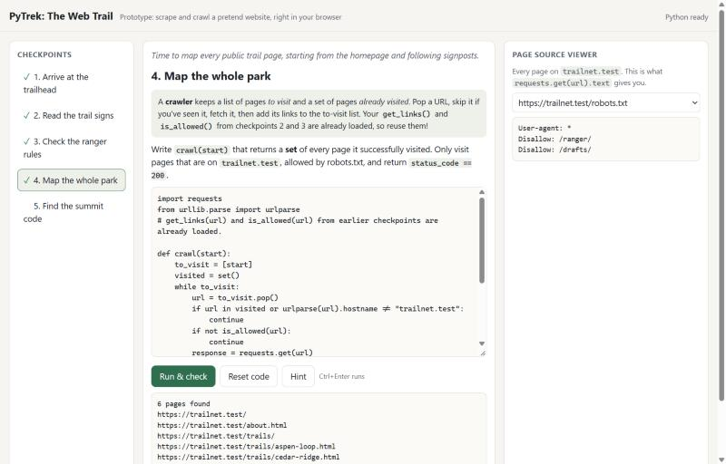
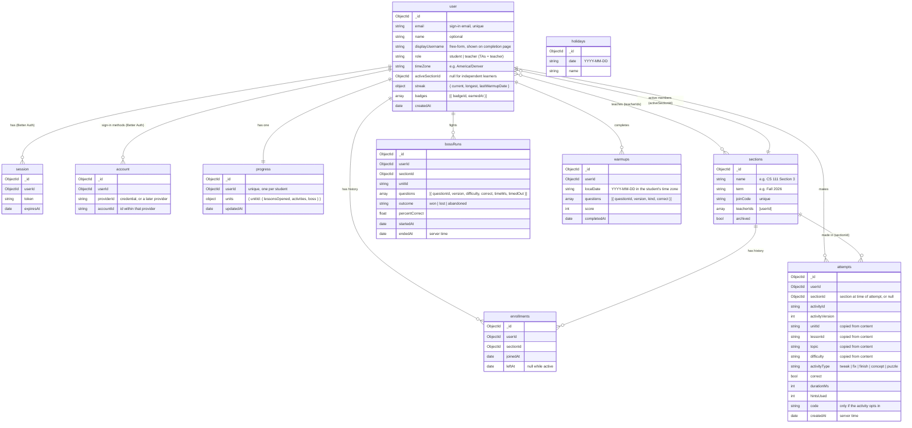
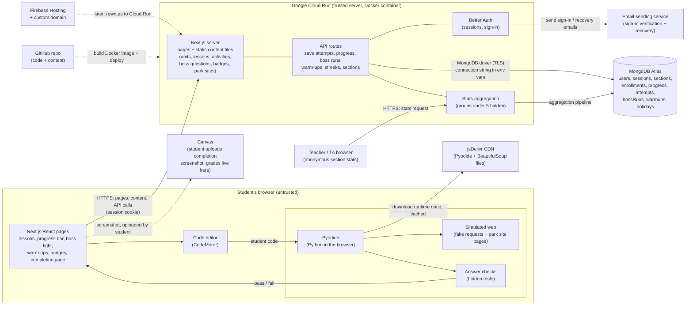

# PyTrek: Initial Design

*CS 452 Final Project, Fall 2026 · Ella Griffioen*

## TL;DR

PyTrek is a learning platform like zyBooks, but built around **fun,
interactive, hands-on content** instead of reading. It's designed for **BYU
CS 111 students and the CS 111 curriculum**. I'm starting with what students
are learning right now, the **web scraping unit**, and, if there's time, I'll
expand it to cover the **entire CS 111 curriculum**.

## Summary

**PyTrek turns BYU CS 111's web-scraping unit into a detective game you play
in the browser.** Students solve a mystery on a national park's website by
writing real Python: scraping pages, following links, respecting
`robots.txt`, decoding clues with regex, and charting data. No installs, no
setup, and it costs students **$0**.

*Early prototype: a student's crawler maps the park's pretend website. Python
runs right in the browser, and the page checks the answer instantly.*

### The problem
- In CS 111, the hands-on practice lives in **labs that are optional and
  ungraded**, so most students skip them.
- Labs also need setup (installing Python and libraries, downloading starter
  files, running tests), which is a barrier for beginners.
- The readings are mostly **read the code, then answer multiple choice**.
  Students don't write code until homework.
- Some topics, like `robots.txt` and how the web works, have **no hands-on
  practice at all**.
- Commercial interactive textbooks like zyBooks cost students around **$90**.

### The solution
A free, game-like practice site for CS 111's web unit (the material on HW05,
Project 04, and Exam 4):

- **Run real Python in the browser.** Pyodide runs each student's code on
  their own computer, so there's nothing to install and no server cost.
- **A safe pretend internet.** Students scrape and crawl a simulated park
  website, so their code looks exactly like real CS 111 code, with no real
  sites involved.
- **Short, hands-on activities** with minimal reading: run an example, change
  one thing to get a new output, fix a bug, finish the code, plus quick concept
  checks.
- **Puzzles:** Regex Locks, Broken Scrapers, Scattered Messages hidden in
  HTML, Link Mazes, Messy Tables, and Finish-the-Crawler.

### The story: *The Case of the Missing Trail Markers*
Someone has been tampering with the park's website. Trail pages point the
wrong way, pages have vanished, and hikers are getting lost. Students play a
junior ranger-detective who discovers the culprit: a **rogue AI agent** that
ignored `robots.txt` and crawled all over the site. To catch the "bad crawler,"
students become the **good crawler**, and every web-unit topic is a tool for
the investigation.

### What makes it fun
- **Boss fight** at the end of each section: pick an easy, medium, or hard
  question (harder does more damage); right answers damage the boss, wrong
  ones damage you; each question is timed.
- **Optional daily warm-up** (5 questions) with a weekday streak; weekends and
  holidays don't break it.
- **Badges** for progress, and a **clear progress bar** with checkpoints.
- **Unlimited attempts:** practice is low-stakes.

### Who it's for
- **CS 111 students:** independent learners can use it on their own; classes
  can join a section with a code.
- **Teachers and TAs:** see **anonymous** section stats (where students get
  stuck), never individual students.

### Goals
1. Cover **all 7 web-unit topics**: HTML + BeautifulSoup, URLs, `robots.txt`,
   crawling, data visualization, regex, and HTTP basics.
2. **Test with real CS 111 students** around the first week of December, while
   they're working on HW05, Project 04, and Exam 4.
3. Keep it **free** ($0–6 per student at most; the pilot costs $0).
4. **Protect student privacy:** grades never live in PyTrek. Students upload a
   screenshot of their completion page to Canvas, and teacher stats hide any
   group under 5 students.
5. Build it so **more units** (like Python basics) can plug in later.

## Initial ERD

PyTrek uses **MongoDB Atlas** (a document database). Each box is a
collection; fields shown as objects or arrays are **embedded** in the
document, and lines are **references** between collections. Lesson content
(units, lessons, activities, boss questions, badges, pretend web pages) is
stored as static files, not in the database.

Key choices:
- **Grades never live in PyTrek.** The completion page (display username,
  unit, best score, server timestamp) is screenshotted to Canvas.
- **Attempts copy the activity's topic, lesson, and difficulty** and the
  student's section at the time, so teacher stats are one aggregation query
  that hides any group under 5 students.
- **One progress document per student**, organized by unit so it can be split
  later.

Full field list, indexes, and the stats query: [data-model.md](data-model.md).

## Rough system design

- **Next.js (React)** pages and API routes in a **Docker** container on
  **Google Cloud Run** (free tier; scales to zero).
- **Pyodide** runs student Python in the browser (in a Web Worker) against a
  **simulated website**, so there's nothing to install and no server cost
  for running code.
- **MongoDB Atlas** stores user data; **Better Auth** handles email + password
  sign-in.
- Pilot cost: **$0**.

Security boundaries, scaling, and costs: [system-design.md](system-design.md).

## Daily goals

No work on Sundays; a lighter Thanksgiving week. Key dates: **pilot live Tue
12/1**, **in-class presentation Wed 12/2**, **final report due Thu 12/10**.
Hours so far: 7.25. Planned below: about 31 more (about 38 total, inside the
30–40 hour target, with room to slip).

| Day | Goal | Hours |
|---|---|---|
| Tue 11/17 | Project summary, daily goals | 1 |
| Wed 11/18 | **Pitch in class** + class channel post; finish this design doc | 1.5 |
| Thu 11/19 | **Submit Initial Design**; interviews; start the Next.js project and Dockerfile locally | 1.5 |
| Fri 11/20 | Foundation: Next.js + Docker deployed to Google Cloud Run ("hello world" live); connect MongoDB Atlas | 2.5 |
| Sat 11/21 | Better Auth email + password sign-in (pick an email service); display username and time zone; sections with join codes + enrollments | 2.5 |
| Mon 11/23 | Pyodide in a Web Worker + CodeMirror editor + simulated web; lesson content file format; port the prototype's checkpoints | 2 |
| Tue 11/24 | Lesson page + progress bar; API to save attempts and progress | 2 |
| Wed 11/25 | *(light)* Content: HTML + BeautifulSoup, URLs | 1 |
| Thu 11/26 | Thanksgiving: off | 0 |
| Fri 11/27 | *(light)* Content: `robots.txt`, crawling, HTTP basics | 1 |
| Sat 11/28 | *(light)* Content: regex, data visualization | 1 |
| Mon 11/30 | Boss fight (timed questions, easy/medium/hard, health) + completion page with server timestamp; full test on Cloud Run; confirm setup with professor | 3 |
| Tue 12/1 | **Pilot live**: share link, watch for bugs, fix; prep presentation | 1.5 |
| Wed 12/2 | **In-class presentation**; collect feedback | 1 |
| Thu 12/3 | Fix pilot feedback; daily warm-up + weekday streak | 1.5 |
| Fri 12/4 | Badges; anonymous teacher stats (groups under 5 hidden) | 1.5 |
| Sat 12/5 | Stretch: start the **Python basics** unit | 1.5 |
| Mon 12/7 | Stretch: Python basics continued; polish | 1.5 |
| Tue 12/8 | Demo video/GIF; final report draft | 1.5 |
| Wed 12/9 | Finish final report; collaboration report; class channel post | 1.5 |
| Thu 12/10 | Final checks and submit | 0.5 |

**If I fall behind, simplify the game** (cut in this order): teacher stats →
badges → warm-ups/streaks → boss difficulty choice (one difficulty) → fewer
puzzles per topic. All 7 topics, the completion page, and saving progress
stay in the pilot.

**Collaboration (3+ hours needed by 12/10):** the pitch, in-class
presentation and feedback, and pilot feedback from CS 111 students and
classmates count toward it.

## UX sketches (optional)
*(to be added)*
