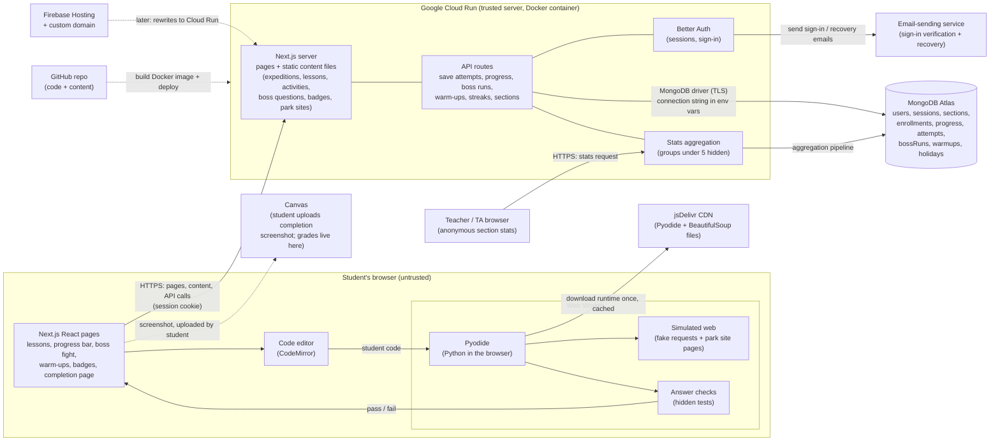

# PyTrek system design (DRAFT for review)

Shapes are technologies; arrows are how they talk. Dashed parts are optional or
come later.

## Components
| Component | Technology | Role |
|---|---|---|
| Frontend | Next.js (React) | Lessons, progress bar, boss fight, warm-ups, badges, completion page, teacher stats page |
| Code editor | CodeMirror | Where students edit example and puzzle code |
| Python runtime | Pyodide in a Web Worker | Runs student Python in the browser; the worker can be stopped for infinite loops and per-question boss timers |
| Simulated web | Fake `requests` module + content files | Lets students scrape and crawl the park website with no internet access |
| Lesson content | Static files in the repo | Expeditions, lessons, activities, boss questions, badges, park site pages; versioned in git |
| Backend | Next.js API routes on Google Cloud Run (Docker) | Saves attempts/progress, manages sections and streaks, computes stats |
| Login | Better Auth (MongoDB adapter) | Sign-in, sessions, account linking |
| Database | MongoDB Atlas | All user data (see [data-model.md](data-model.md)) |
| Grades | Canvas (outside PyTrek) | Students upload a completion screenshot |

## Main flows
1. **Doing a lesson:** the browser loads the lesson's content files from the
   server, runs the student's code in Pyodide against the simulated web, checks
   the answer in the browser, then calls the API to save the attempt and
   update progress.
2. **Boss fight:** questions are timed per question in the browser; the
   finished run is saved to `bossRuns`, and the server stamps the completion
   time used on the completion page.
3. **Daily warm-up:** the server picks 5 questions from lessons the student has
   opened (and all earlier ones), using the student's time zone for the
   weekday streak and the `holidays` list.
4. **Teacher stats:** the server runs an aggregation over `attempts` for the
   teacher's section and returns only totals, hiding any group under 5 students.
5. **Grades:** the student screenshots the completion page (display username,
   expedition, best score, timestamp) and uploads it to Canvas.

## Security boundaries
| Boundary | What's trusted | Protections |
|---|---|---|
| **Browser ↔ server** | The browser is untrusted | HTTPS only; session cookie is httpOnly, Secure, SameSite; every API route checks the session and that the user only touches their own data; teachers only get anonymous totals |
| **Student code** | Runs only in the student's own browser | Pyodide runs in a sandboxed Web Worker with no real network access (simulated web), so student code can't reach the server or other students |
| **Answer checking** | Happens in the browser, so it can be bypassed | Accepted risk: grades come from screenshots anyway; completion timestamps come from the server, not the student's clock |
| **Server ↔ database** | Only the server talks to MongoDB | Database credentials only in environment variables; least-privilege database user; the browser never sees the connection string |
| **Atlas network access** | Cloud Run has no fixed IP, so Atlas allows connections from anywhere (`0.0.0.0/0`); the password is the only gate | Long autogenerated password stored only in Secret Manager and `.env.local`; TLS required; database user limited to the `pytrek` database; rotate immediately if exposed. **Later (Level 3 / real student records):** a fixed outbound IP (VPC + Cloud NAT) or private networking with a paid Atlas tier |
| **Secrets in deployment** | Cloud Run reads `MONGODB_URI` from Google Secret Manager | Only Cloud Run's service account can read that one secret; never in code, images, or deploy commands |
| **Sign-in** | Handled by Better Auth with email + password | Passwords hashed by Better Auth (never stored in plain text); email verification and password reset by email; rate-limited sign-in attempts; providers are swappable |
| **Privacy (FERPA)** | Grades never stored in PyTrek | Anonymous section stats with a minimum group of 5; student code not saved by default |

## Scaling
- **Student code costs the server nothing:** Pyodide runs on each student's
  own computer, so more students doesn't mean more server compute for Python.
- **Cloud Run** scales from zero to many container copies automatically when a
  whole class logs in before a deadline. Cold starts after idle take a few
  seconds.
- **Static content** is served with the app and can be cached, so lessons don't
  hit the database.
- **MongoDB Atlas** free tier handles about 100 operations/second; upgrade to
  Flex ($8–30/month, up to 500 ops/sec) or a dedicated cluster as usage grows.
- **One database connection is reused** per container so Cloud Run copies
  don't exhaust Atlas connection limits.

## Costs (checked 11/16/2026)
| Piece | Pilot (~200 students) | ~10,000 active students |
|---|---|---|
| Cloud Run | $0 (free tier) | Low; mostly free tier, then pay per use |
| MongoDB Atlas | $0 (free M0) | ~$8–30/month (Flex) |
| Pyodide CDN | $0 | $0 |
| Better Auth | $0 (open source) | $0 |
| Custom domain (optional) | ~$10–20/year | same |
| **Per student** | **$0** | **well under $0.01/month** |

## Sign-in at BYU
Students sign in with an email (e.g. their BYU email) rather than Google, since
BYU may not allow requiring Google accounts. BYU's own sign-in could be added
later through Better Auth's SSO plugin with BYU IT approval. Sign-in uses email
+ password; the email-sending service will be chosen when building.
